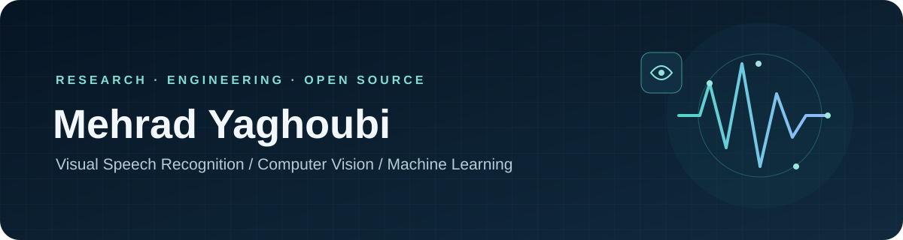

  
  
  
  

<h3 align="center">AI researcher & engineer · Visual Speech Recognition · Computer Vision</h3>

  <a href="#-featured-projects">Projects</a> ·
  <a href="#-research">Research</a> ·
  <a href="#-applied-ai">Applied AI</a> ·
  <a href="#-toolbox">Toolbox</a> ·
  <a href="#-connect">Connect</a>

---

## 👋 About

I am an **AI Specialist** and M.Sc. researcher in Artificial Intelligence at Islamic Azad University, Karaj. My research focuses on **visual speech recognition (lip reading)**, **knowledge distillation**, **uncertainty-aware learning**, and efficient deep learning.

I enjoy turning research ideas into practical, clearly documented software—from computer vision tools to AI-powered web applications.

## 🚀 Featured projects

<table>
  <tr>
    <td width="50%" valign="top">
      <h3>👄 PyLipExtractor</h3>
      
Python tools to extract and stabilize lip regions in video for visual speech recognition and lip-reading workflows.

      

      MediaPipe · temporal smoothing · illumination normalization · CPU/CUDA video conversion
    </td>
    <td width="50%" valign="top">
      <h3>🧠 EGOSD</h3>
      
Research implementation and experiment notes for entropy-gated self-distillation in visual speech recognition.

      

      Knowledge distillation · uncertainty-aware learning · lip-reading research
    </td>
  </tr>
</table>

## 🔬 Research

I study how compact lip-reading models can learn from stronger models while accounting for uncertainty.

- **[Entropy-gated online self-distillation for lightweight lip reading](https://papers.ssrn.com/sol3/papers.cfm?abstract_id=6831426)** — preprint; under review at *The Visual Computer* (status as reported in my CV).
- **[Uncertainty-gated, belief-guided decision-making for Go](https://arxiv.org/abs/2607.26946)** — preprint.

## 🛠️ Applied AI

At Ghasedak Peik Shahr, I build AI and web tools for travel services. My work includes a Persian-language booking chatbot and WordPress integrations for Parsegasht and TaxiRooz, a competitor price-checking bot, an operator training dashboard, and a custom homepage theme.

I have also built an API-based OCR application. A personal retrieval-augmented generation (RAG) chatbot is in development.

## 🧰 Toolbox

  
  
  
  
  
  
  
  

**Focus areas:** machine learning · visual speech recognition · lip reading · computer vision · video processing · model distillation · efficient inference · REST APIs

## 🌍 Connect

- 🌐 [Academic profile and public CV](https://mehradyaghoubi.github.io/) · [صفحه فارسی](https://mehradyaghoubi.github.io/fa/)
- 🎓 [Google Scholar](https://scholar.google.com/citations?user=7X057KcAAAAJ) · [ORCID](https://orcid.org/0009-0001-8116-5864)
- 💼 [LinkedIn](https://www.linkedin.com/in/mehrad-yaghoubi)
- ✉️ [Email](mailto:mehradyaghoubi96@gmail.com)
