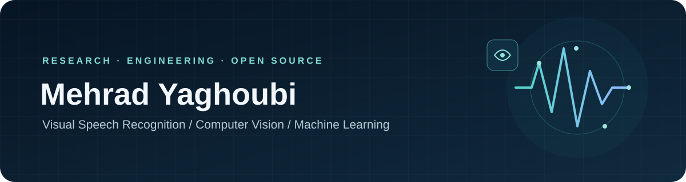

  
  
  
  

<h3 align="center">AI researcher & engineer · Visual Speech Recognition · Computer Vision</h3>

  <a href="#-featured-projects">Projects</a> ·
  <a href="#-open-source-contributions">Contributions</a> ·
  <a href="#-research">Research</a> ·
  <a href="#-applied-ai">Applied AI</a> ·
  <a href="#-toolbox">Toolbox</a> ·
  <a href="#-connect">Connect</a>

---

## 👋 About

I am **Mehrad Yaghoubi (مهراد یعقوبی)**, an **AI Specialist** and M.Sc. researcher in Artificial Intelligence at Islamic Azad University, Karaj. My research focuses on **visual speech recognition (lip reading)**, **knowledge distillation**, **uncertainty-aware learning**, and efficient deep learning.

I develop computer vision tools, chatbots and web applications alongside my research. I am seeking a **fully funded PhD** in computer vision, visual speech recognition, efficient deep learning or model optimization.

## 🚀 Featured projects

<table>
  <tr>
    <td width="50%" valign="top">
      <h3>👄 PyLipExtractor</h3>
      
Python tools to extract and stabilize lip regions in video for visual speech recognition and lip-reading workflows.

      

      MediaPipe · temporal smoothing · illumination normalization · CPU/CUDA video conversion
    </td>
    <td width="50%" valign="top">
      <h3>🧠 EGOSD</h3>
      
Research implementation and experiment notes for entropy-gated self-distillation in visual speech recognition.

      

      Knowledge distillation · uncertainty-aware learning · lip-reading research
    </td>
  </tr>
</table>

## 🤝 Open-source contributions

### Research & Engineering Router

I created and maintain **Research & Engineering Router**, an open-source skill for evidence selection in coding and research workflows. It helps the primary model focus on relevant files and sources, with optional model-assisted routing.

[Explore the project](https://github.com/MehradYaghoubi/jev-research-engineering) · [XERJ Corpus Hub contributor profile](https://hub.xerj.org/contributors/MehradYaghoubi)

## 🔬 Research

I study how compact lip-reading models can learn from stronger models while accounting for uncertainty.

- **[Entropy-gated online self-distillation for lightweight lip reading](https://papers.ssrn.com/sol3/papers.cfm?abstract_id=6831426)** — preprint; under review at *The Visual Computer* (status as reported in my CV).
- **[Uncertainty-gated, belief-guided decision-making for Go](https://arxiv.org/abs/2607.26946)** — preprint.

## 🛠️ Applied AI

My applied AI work includes a Persian-language travel-booking chatbot, WordPress integrations, a competitor price-checking bot, an operator training dashboard, and a custom website theme.

I have also built an API-based OCR application. A personal retrieval-augmented generation (RAG) chatbot is in development.

## 🧰 Toolbox

**AI and vision:** Python · PyTorch (CUDA) · OpenCV · MediaPipe

**Web and tooling:** FastAPI · REST APIs · WordPress · Git · Linux · Docker

**Databases and querying:** SQL · MySQL · PostgreSQL

**Focus areas:** machine learning · visual speech recognition · lip reading · computer vision · video processing · model distillation · efficient inference · REST APIs

## Experience and resumes

- **AI Specialist, Ghasedak Peik Shahr** — two months in 2026. Built a Persian travel chatbot with three WordPress plugins, a competitor price-checking bot, and an operator training dashboard and custom homepage for Parsegasht.
- **Co-founder, Fidar Technology Fartak** — 1.5 years. A university startup project developing games informed by psychology for crime prevention. The venture was not formally incorporated.
- **University research activity** — 1.5 years at the Research Center, Islamic Azad University, Karaj.
- **Software Instructor** — one year at the Faculty of Work and Skills, Islamic Azad University, Karaj.
- **Programming Instructor** — one year at Net College Institute.
- **Robotics Instructor** — one year at Mohandesin Bartar Institute.

[Academic CV — PDF](https://mehradyaghoubi.github.io/resumes/Mehrad-Yaghoubi-Academic-CV.pdf?v=skills-20261110) · [Work resume — PDF](https://mehradyaghoubi.github.io/resumes/Mehrad-Yaghoubi-AI-Engineering-Resume.pdf?v=skills-20261110) · [رزومه کاری فارسی — PDF](https://mehradyaghoubi.github.io/resumes/Mehrad-Yaghoubi-AI-Engineering-Resume-FA.pdf?v=skills-20261110)

## 🌍 Connect

- 🌐 [Academic profile and public CV](https://mehradyaghoubi.github.io/) · [صفحه فارسی](https://mehradyaghoubi.github.io/fa/)
- 🎓 [Google Scholar](https://scholar.google.com/citations?user=7X057KcAAAAJ) · [ORCID](https://orcid.org/0009-0001-8116-5864)
- 💼 [LinkedIn](https://www.linkedin.com/in/mehrad-yaghoubi)
- ✉️ [Email](mailto:mehradyaghoubi96@gmail.com)
